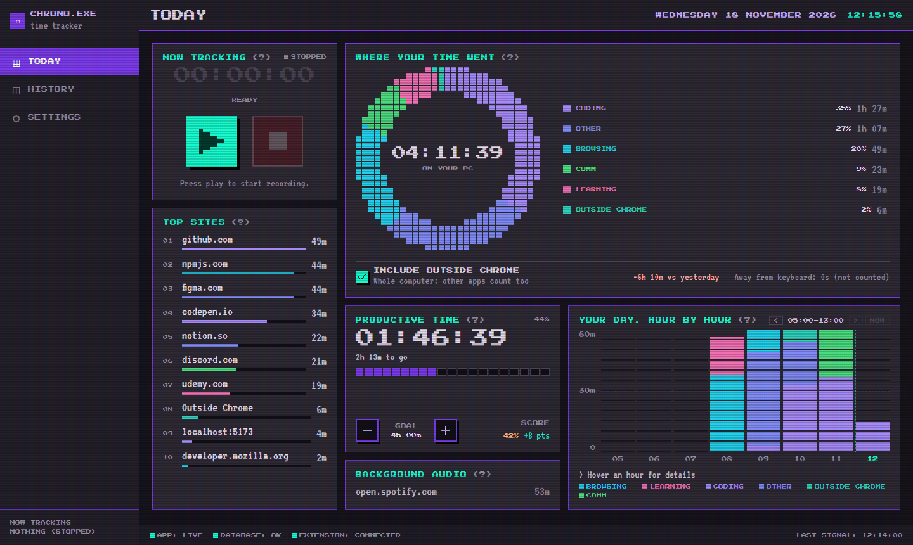
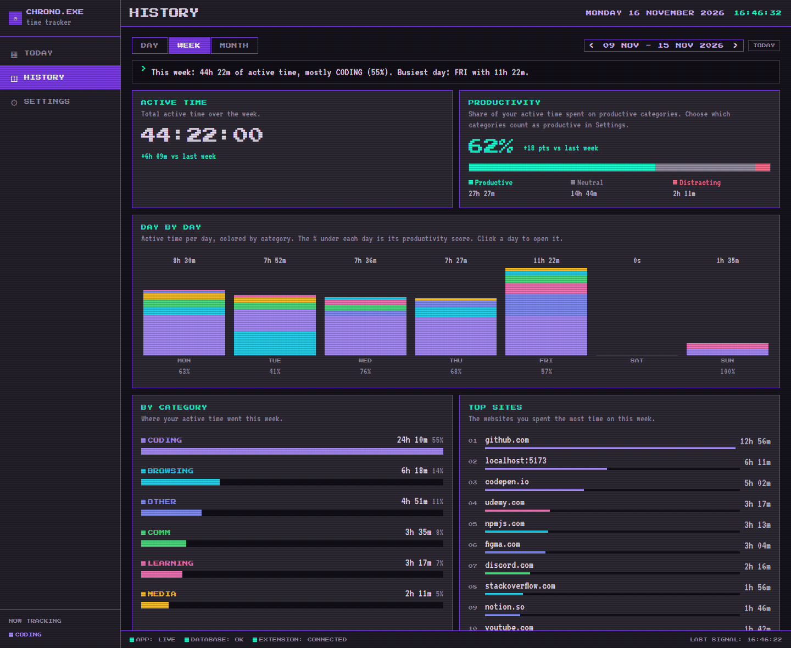
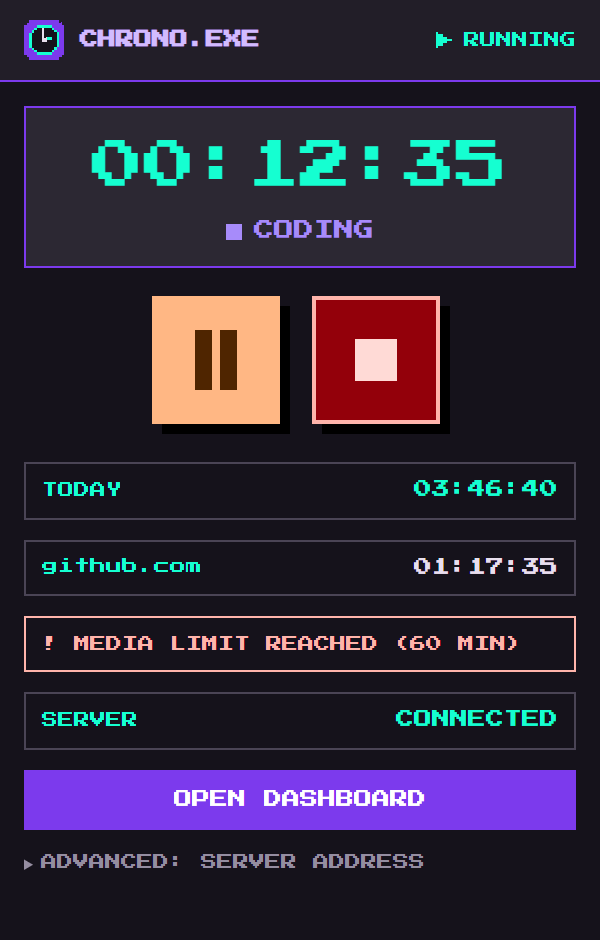
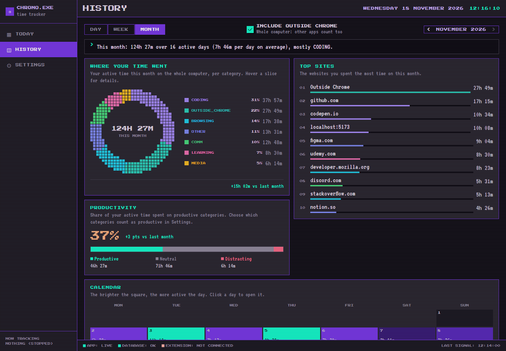
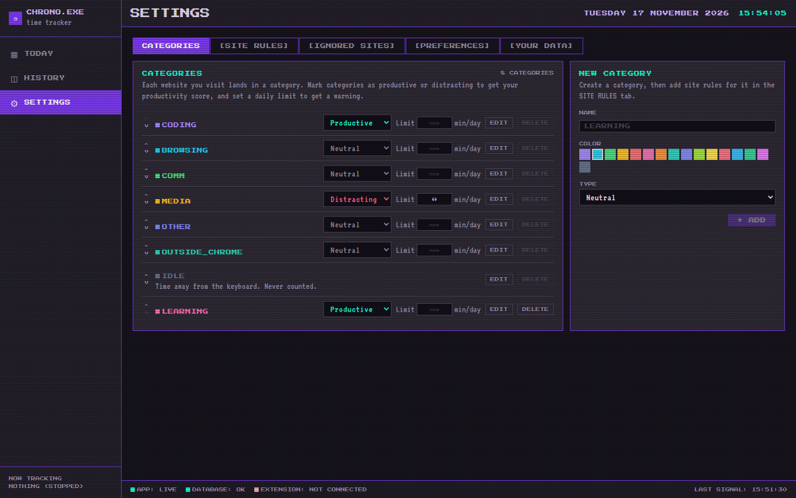

# CHRONO.EXE

> See where your screen time goes. A retro, arcade-style time tracker for Chrome.


CHRONO.EXE measures what you do in your browser and turns it into a history you can analyze. Press play, browse as usual, and a Chrome extension reports what you are doing. The app then tells you where your time went: which categories, which websites, how productive the day was, and how it compares with yesterday or last week.

Everything runs on your own computer, and the database is a single local file. No browsing data leaves your machine.



| History: week | Extension popup |
| --- | --- |
|  |  |

| History: month | Settings: categories |
| --- | --- |
|  |  |

---

## Features

**Three screens**
- **TODAY**:
  - play / pause / stop with a stopwatch, and the category and site you are on;
  - active time with a productive-time goal you can edit in place;
  - a one-line summary of the day;
  - productivity score, time per category and top sites;
  - background audio and an hour-by-hour timeline.
- **HISTORY**: the same report for any DAY, WEEK or MONTH, each compared with the previous period.
  - DAY adds an activity log and CSV export.
  - WEEK shows stacked bars per day.
  - MONTH is a calendar heatmap.
- **SETTINGS**:
  - categories (color, productive / neutral / distracting, daily limit);
  - site rules with a live URL tester, and ignored sites;
  - goal and away delay;
  - your data (export, restore, delete).

**Analysis**
- **Top sites**: each activity is split between the websites visited during it.
- **Productivity score**: the share of active time spent on categories marked *productive*. The daily goal is about productive time (4h by default).
- **Trends**: every figure is compared with the previous period, for example `+35m vs yesterday` or `-13 pts vs last week`.
- **Daily limits**: you can give a category a limit, for example MEDIA at 1h a day.
  - The app flags it in red.
  - The extension sends a `WARNING: LIMIT REACHED` notification once a day.
- **Plain-English summary**: one sentence per period.

**Accurate measurement**
- **Foreground only.** Only the tab you are looking at counts. When Chrome is in the background (VS Code, Word…), that time goes to `OUTSIDE_CHROME`.
- **Tab and app switches** are reported immediately (throttled to 3s), not only on the 30s heartbeat.
- **Background audio** (music or a video playing in another tab) is shown separately and never counted as active time.
- **Away detection.** After a configurable delay without mouse or keyboard input, the time is marked *away* and not counted.
- **Gaps are honest.** If the laptop sleeps or Chrome is closed, the activity ends where it really ended.
- **Midnight and time zone.** Activities that cross midnight are split between both days, and all days use local time.

**Chrome extension (Manifest V3)**
- **Controls:** big pixel-art play/pause and stop buttons, in sync with the app.
- **Badge:** the toolbar icon shows today's active time (`3h4`, `45m`) in a different color for each state.
- **Popup:** today's total, time spent on the current site, and any limit warnings.
- **Setup:** it finds the local server on its own (it scans common ports through `/api/health`).
- **One-click server (Windows):** with the native launcher installed, play starts the server in the background and stop shuts it down. Pause keeps it running. No terminal to keep open.

**Privacy**
- Addresses are stored without query strings or fragments, and page titles are never stored.
- One click exports everything as JSON, restores a backup, or deletes the history.

## Tech stack

| Layer | Tech |
| --- | --- |
| App | Next.js 14 (App Router), React 18, TypeScript (strict) |
| Styling | Tailwind CSS 3, *Press Start 2P* (titles) and *VT323* (text) pixel fonts, CRT scanline overlay |
| Data | Prisma 5 + SQLite (one local file, no server) |
| Validation | Zod on every API route |
| Real-time | Server-Sent Events (`EventSource`) |
| Sensor | Chrome Extension, Manifest V3 (TypeScript) |
| Quality | Jest: unit tests plus integration tests of the real API routes on a throwaway SQLite database. 86% backend coverage, 80% enforced in CI. ESLint, GitHub Actions |

## Architecture

```
┌──────────────────────┐  POST /api/heartbeat    ┌───────────────────────────────────────┐
│  Chrome extension    │ ─ every 30s + on tab ─► │  Next.js API                          │
│  (service worker)    │   or app switch         │   ignore list → categorizer (rules)   │
└──────────────────────┘                         │   → session state machine → SQLite    │
                                                 │   → broadcast snapshot (SSE)          │
┌──────────────────────┐   GET /api/sse          └───────────────────────────────────────┘
│  Web app (React)     │ ◄────── live snapshots ────────────────┘
│  + REST for reports  │ ──── /api/stats, /api/timeline, /api/tracking … ────►
└──────────────────────┘
```

**Session state machine** (`src/lib/sessionLogic.ts`, pure and unit-tested). Each heartbeat leads to one of these outcomes:

| Situation | Outcome |
| --- | --- |
| No open session | **start** a new one |
| Same category and same away state | **extend** the open session |
| Category or away state changed | **switch**: close at this heartbeat, open a new one |
| No heartbeat for longer than the threshold | **gap**: close at the last heartbeat + 30s, then start a new one |
| Heartbeat older than the last one (late retry) | **stale**: stored, but it doesn't move the session math |

Heartbeats are idempotent: replaying the same timestamp never creates a duplicate.

**Why `globalThis` for the SSE registry?** Next.js compiles each route into its own bundle, so module-level state is not shared between `/api/heartbeat` and `/api/sse`. The client registry and the caches live on `globalThis`, which every route in the process shares.

## Getting started

**Prerequisites:** Node.js ≥ 18.18 and Google Chrome. No database server is needed.

```bash
git clone <repo-url> chrono-exe && cd chrono-exe
npm install
cp .env.example .env        # DATABASE_URL="file:./chrono.db"
npm run setup               # creates the local database and default categories
npm run dev                 # http://localhost:3000
```

Want something to look at right away? Load 5 weeks of realistic demo data:

```bash
npm run db:demo             # add "-- --reset" to wipe existing activity first
```

### Install the extension

1. Open `chrome://extensions` and enable **Developer mode**.
2. Click **Load unpacked** and select the `extension/` folder (the compiled `.js` files are committed; `npm run build:extension` rebuilds them).
3. Pin **CHRONO.EXE**, then press play in the popup or in the app.

The extension only has host permissions for `localhost` and `127.0.0.1`. Time spent on the CHRONO.EXE tab itself shows up as "CHRONO.EXE dashboard" in top sites.

### Daily use: start the server from the extension (Windows)

Chrome extensions cannot start programs, so by default the server must already be running (`npm run dev`). The native launcher removes that step:

```bash
npm run launcher:install     # builds the app, registers the launcher with Chrome (current user, no admin)
```

Then reload the extension in `chrome://extensions`. From now on:

| You press | What happens |
| --- | --- |
| ▶ play (server off) | The popup shows `BOOTING...`, the server starts in the background on `127.0.0.1:3005` (about 1s), recording begins |
| ❚❚ pause | Recording pauses, the server keeps running so the dashboard stays available |
| ■ stop | Recording stops and the server shuts down. An open dashboard shows `SERVER OFF` and reconnects by itself on the next play |

How it works: the extension calls [`chrome.runtime.sendNativeMessage`](https://developer.chrome.com/docs/extensions/develop/concepts/native-messaging). Chrome runs `launcher/host.mjs`, which starts `next start` detached (production build in `.next-app/`, so it never clashes with `next dev`) with `CHRONO_LAUNCHER=1`. Only a server started this way stops itself on stop; `npm run dev` is never shut down. Only this extension may call the launcher: the manifest has a fixed `key`, so its ID is stable, and the launcher allows that ID only. Server output goes to `launcher/server.log`, and each launcher call is logged in `launcher/host.log`.

If the popup says `Specified native messaging host not found`, the launcher is not registered: run `npm run launcher:install` again from a regular terminal (not from a sandboxed tool, which cannot write to the Windows registry).

Run `npm run launcher:install` again after changing the code (it rebuilds), and `npm run launcher:uninstall` to remove it.

## Scripts

| Script | What it does |
| --- | --- |
| `npm run dev` | Next.js dev server |
| `npm run build` / `start` | Production build / server |
| `npm run setup` | Apply migrations and seed defaults |
| `npm run db:seed` | Default settings, categories, rules and ignore list (idempotent) |
| `npm run db:demo` | Deterministic demo data (35 days) |
| `npm run db:reset` | Recreate an empty database |
| `npm test` / `test:coverage` | Unit and integration tests / with the coverage threshold |
| `npm run lint` / `typecheck` | ESLint / TypeScript for the app and the extension |
| `npm run build:extension` | Compile the extension TypeScript |
| `npm run launcher:install` / `launcher:uninstall` | Let the extension start and stop the server (Windows) |
| `npm run icons` | Regenerate the pixel-art icons (no image dependency) |
| `node scripts/screenshots.mjs <url>` | Capture the README screenshots with your installed Chrome |

## API

| Method | Route | Purpose |
| --- | --- | --- |
| `POST` | `/api/heartbeat` | Ingest a heartbeat `{ url, timestamp, idleSeconds, backgroundAudio[] }` |
| `GET POST` | `/api/tracking` | Play / pause / stop; `GET ?url=` also returns today's total and the current site's time |
| `GET` | `/api/sse` | Live stream (`DASHBOARD_UPDATE`, `DB_UNREACHABLE`) |
| `GET` | `/api/stats?period=day\|week\|month&date=YYYY-MM-DD` | Report: categories, top sites, productivity, limits, background audio, previous period |
| `GET` | `/api/sessions?date=YYYY-MM-DD` | Chronological activities of a day |
| `GET` | `/api/timeline?date=YYYY-MM-DD` | Timeline blocks of a day |
| `GET POST PUT PATCH DELETE` | `/api/categories` | CRUD (productivity type, daily limit); `PATCH` reorders |
| `GET POST PUT PATCH DELETE` | `/api/rules` | CRUD; `PATCH` reorders (evaluation order) |
| `GET POST DELETE` | `/api/ignore-patterns` | Ignored sites |
| `GET PUT` | `/api/settings` | Productive goal and away delay |
| `GET POST DELETE` | `/api/data` | Export everything / restore a backup / delete the history |
| `GET` | `/api/health` | Lets the extension find the server |

Errors share one shape: `{ code, message, details? }`. For example, `VALIDATION_ERROR` returns 400, `CONFLICT` 409 and `DB_UNREACHABLE` 503.

## Project structure

```
src/
  app/            pages (today, history, settings) + API routes
  components/     layout shell, live provider, report blocks, UI kit (Widget, PixelIcon, TimelineStrip, SegmentedBar…)
  hooks/          useSSE, useDashboard, useApi, useDateParam, useNow
  lib/            glob, categorizer, sessionLogic, sessionManager, aggregate, stats, summary, sse, time
  types/          shared domain and API types
extension/        Chrome MV3 extension (background service worker + popup)
launcher/         native messaging host: starts the server when play is pressed
prisma/           schema, migrations, seed, demo data
__tests__/        unit tests (lib) and integration tests (api)
docs/             PRD, architecture, UI guidelines, screenshots
```

## Configuration

| Variable | Default | Meaning |
| --- | --- | --- |
| `DATABASE_URL` | `file:./chrono.db` | SQLite file, relative to `prisma/` |
| `SSE_INACTIVITY_THRESHOLD_MS` | `120000` | Silence after which the extension counts as offline and the open activity is closed |
